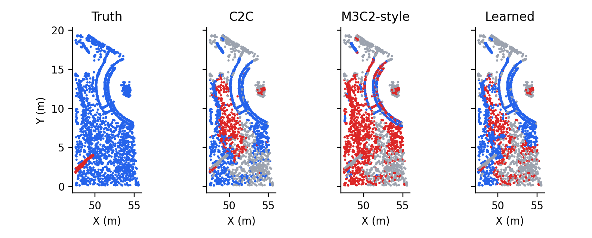
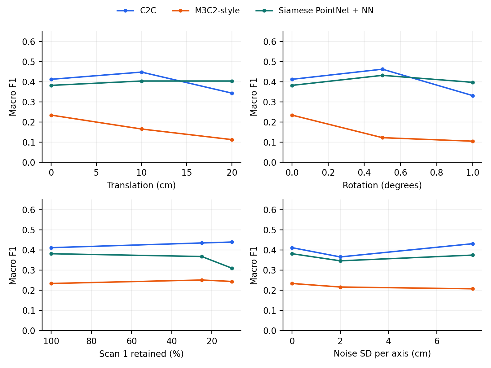
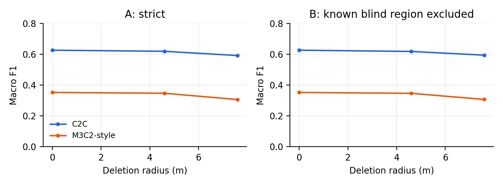
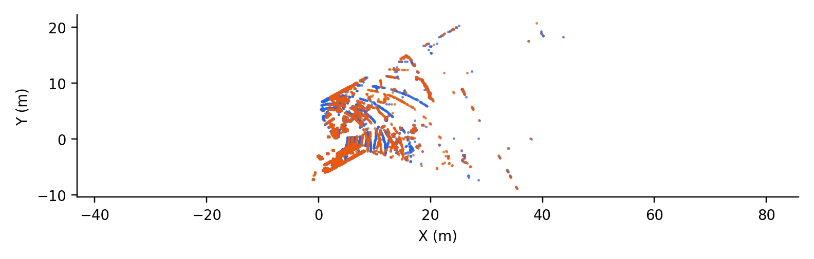

# Robust 3D Change Detection for Construction Progress Monitoring

Vishwanath Venugopal CE23B124 and Shaik Koduru Asif CE23B114

## Abstract

We evaluate nearest-neighbour C2C, an uncertainty-aware M3C2-style detector, and a compact Siamese PointNet-style network on labelled construction point clouds. An independently audited geometry implementation passes 19 synthetic tests. A buffered same-scene study samples 4,000 original cores per epoch with full-cloud geometric support. On common valid clean support, pooled three-class macro F1 is 0.412 for C2C, 0.234 for M3C2-style and 0.382 for the learned model, at 66.88% coverage. Controlled registration, density, noise and occlusion experiments expose different failure modes. Neither added complexity nor nominal statistical significance guarantees better detection. Historical same-pair threshold selection, spatial distribution shift and abstention bias limit generalization claims. ConSLAM supplies qualitative site context, not change-accuracy labels.

## 1 Introduction

Repeated site scans can reveal additions and removals, but spatial discrepancies also arise from imperfect registration, density, range noise, moving objects and occlusion. A useful progress-monitoring aid must distinguish these explanations and expose unsupported regions. Geometry alone does not identify a completed wall, certify an installed quantity or establish schedule status.

This course project asks how detection accuracy changes when point-cloud quality deteriorates. Our contribution is a reproducible empirical comparison with explicit original-point support, controlled one-sided perturbations and a saved abstention policy. We report negative findings rather than assume that surface-normal methods or learning must outperform proximity thresholding. We do not propose a new state-of-the-art detector.

## 2 Related work and data

MultiChange3D provides co-registered, labelled epoch pairs spanning sensors and scenes [1]. Its public benchmark includes distance-based, displacement and learned approaches. M3C2 measures local separation along surface normals with an uncertainty estimate [2]. Our implementation checks mean-mode conventions against pinned CloudCompare source [3], while using a different normal-quality rule. PointNet processes unordered point sets through shared point functions and symmetric pooling [4]. We adapt that design to paired patches; we do not reproduce the more elaborate Siamese KPConv reference [5].

## 2.1 Labelled construction scans

Quantitative data are Bike Parking Construction pair_01, with 4,444,935 and 5,089,793 MLS points. The local PLY element is params and includes XYZ, intensity and cd_type. Official label-preparation code assigns 0 unchanged and 1 changed in both epochs. Changed Scan 0 points denote removals; changed Scan 1 points denote additions. We preserve original row indices and all source fields. Intensity is retained in data but excluded from the learned geometry inputs.

Only pair_01 was locally available. Official links for the five missing construction pairs and optional small Open Space MLS scene redirected to Microsoft sign-in. No access controls were bypassed and no files were downloaded. Consequently, all quantitative claims remain same-pair and same-scene. ConSLAM Sequence 3 supplies existing local LiDAR, normalized poses and TLS context [6], without verified change labels.

MultiChange3D data are CC BY-NC-SA 4.0 and its code is MIT. ConSLAM software is restricted to academic use; the article record reserves rights. We retain attribution and exclude original full clouds and ConSLAM files from the submission bundle.

## 3 Methods and implementation audit

C2C queries the nearest point in the opposite full cloud and predicts changed when Euclidean distance is strictly greater than 0.075 m. The historical threshold came from an 11-threshold sweep on the same full pair. We preserve that exploratory result and keep the threshold fixed for every new condition. The public benchmark classical binary metric agrees with our per-original-point confusion calculation; our pooled directional three-class summary is a project-defined extension, not a reproduction of published benchmark scores.

For each M3C2-style core, source-epoch spherical PCA estimates candidate normals at radii 0.10, 0.20 and 0.40 m. Each needs at least 10 points, curvature at most 0.10, normalized eigengap at least 0.10 and tangent eigenvalue ratio at least 0.05. A candidate must agree within 30 degrees with another adequate scale. We select minimum curvature, breaking ties by smaller radius, and orient the largest absolute normal component positive.

The same core-centered finite cylinder selects both epochs: transverse distance at most 0.10 m and absolute normal projection at most 1.0 m. We compute target minus source projected mean, population projected standard deviations s0 and s1 (ddof=0), and counts n0,n1. LoD95 equals 1.96 times [sqrt(s0 squared/n0 + s1 squared/n1) + registration_error]. Changed requires absolute mean separation greater than both LoD95 and a 0.02 m application effect floor.

CloudCompare v2.13.2 revision 49dbbb6 confirms the mean-difference sign, population spread, registration-term placement, strict significance comparison and shared symmetric cylinder [3]. Its interface uses projection diameters; ours uses radii. Normal selection, quality rejection and explicit unknown policy differ. No reference-application output check was available, so we consistently call the method M3C2-style.

Invalid normals, fewer than 10 projected neighbours in either epoch, invalid uncertainty or oversized candidate queries yield unknown (-1), with a saved reason. We process one core neighbourhood at a time, rejecting enclosing-sphere queries above 250,000 candidates rather than truncating them. Registration uncertainty is a separate parameter set to zero. This conditions the LoD on no modelled registration error; a historical 1.64 cm NN median is not a registration RMS. Correlated LiDAR points weaken a literal nominal 95% interpretation.

## 3.1 Verification

All 19 synthetic tests passed, covering identical/offset/oblique planes, tangential motion, sign reversal, common translation, controlled noise, analytical spread and LoD, cylinder boundaries, invalid support and abstention semantics. An independent streamed check over both complete real clouds matched six saved cylinders. Recomputing 416 Stage 3 metric values from 32 confusion-count rows agreed within 5e-9. Historical occlusion CSVs lack confusion counts, so their combined scores could not be reconstructed independently. No tested geometry bug justified changing the detector to chase a higher score.

## 3.2 Compact learned comparison

The course baseline uses one shared 3-32-64 point MLP for both patches, masked max and mean pooling, and a 387-64-32-1 fusion head on both embeddings, their absolute difference and three geometry features. Those features are capped patch counts and capped target NN distance. Thus the model is explicitly a Siamese PointNet-style network with an NN prior. It is not a pure context-only ablation or a reproduction of Siamese KPConv.

Each original query centers both epoch patches in the same coordinate frame. Each patch contains up to 128 nearest points within 0.60 m, with zero padding and masks; displacement is retained. Source and target can contain different numbers of points. Labels enter only weighted binary supervision. Inputs contain relative XYZ and geometry support, never cd_type or absolute location. The same model predicts binary changes for either source direction; epoch membership supplies the removal/addition interpretation.

CUDA training uses seed 42, 16,000 clean training cores, AdamW at 0.001, batch 128, 30 fixed epochs and positive loss weight 3.6976. Calibration loss selects epoch 1; a fixed calibration grid selects threshold 0.7. Neither choice uses new test scores, and no stress threshold is retuned. Four tests check permutation/padding invariance, translation invariance, empty targets and synthetic trainability. Training loss falls while later calibration loss rises, exposing overfitting.

## 4 Experimental setup and clean results

Geometry-defined X regions contain 8,000 training, 1,000 calibration and 4,000 test original cores per epoch. Their bounds are [27.7864,40.2857], [42.5077,45.2854] and [47.5074,55.5625] m. The 2.2221 m gaps exceed twice the largest clean geometric support halo (1.005 m), and exceed the learned patch diameters. Both epochs occur in every region. Within each region, a deterministic occupied-2 m-tile sampler balances spatial coverage and preserves original indices. Sparse tiles therefore receive more weight than under uniform point sampling.

Calibration support diagnostics freeze the retained configuration before new test/stress scoring. Full original or perturbed clouds supply support; normals are re-estimated on perturbed Scan 1. Doubling the pilot to 4,000 cores covers 11 conditions without a full-cloud sweep. Prior full-pair selection and pilot inspection prevent a fully blind benchmark-test claim.

| Method | Macro F1 | Macro mIoU | Directional F1 | Eval coverage | Detector unknown | Search s |
| --- | --- | --- | --- | --- | --- | --- |
| C2C | 0.4118 | 0.3340 | 0.1699 | 66.88% | 0.00% | 2.45 |
| M3C2-style | 0.2342 | 0.1561 | 0.0654 | 66.88% | 33.12% | 24.84 |
| Siamese + NN | 0.3817 | 0.3091 | 0.1340 | 66.88% | 0.00% | 2.84 |

Table 1. Clean comparison on identical 2,563/2,787 valid directional cores (5,350 total). Search includes full-support tree construction; geometric times are CPU and learned patch inference uses CUDA. Shared-process peaks were about 913 MiB for geometry and 1,632 MiB for learned inference, not isolated algorithm allocations. Training took 23.47 s, with 89 MiB peak allocated GPU memory and 108 MiB reserved; feature construction is separate.

| Method | Direction | Precision | Recall | F1 | Changed IoU |
| --- | --- | --- | --- | --- | --- |
| M3C2-style | removed | 0.0173 | 1.0000 | 0.0339 | 0.0173 |
| M3C2-style | added | 0.0509 | 1.0000 | 0.0968 | 0.0509 |
| C2C | removed | 0.0418 | 0.8519 | 0.0797 | 0.0415 |
| C2C | added | 0.1508 | 0.9419 | 0.2600 | 0.1494 |
| Siamese + NN | removed | 0.0359 | 0.8519 | 0.0690 | 0.0357 |
| Siamese + NN | added | 0.1144 | 0.7674 | 0.1991 | 0.1106 |

M3C2-style abstains on 33.125% of requested test cores. Changed-class valid coverage is only 24.3% for removals and 31.5% for additions; valid-only recall is therefore conditional and selective. Conservative correct-valid/all-core accuracy is 27.61%, 54.48% and 52.48% for M3C2, C2C and learned predictions on common support. C2C and the learned model themselves never abstain; their all-sampled macro F1 values, 0.4457 and 0.3936, are retained separately. Unknowns are never relabelled unchanged.

## 5 Robustness under simulated imperfections

Only Scan 1 changes. We reuse the existing Stage 3 helpers with seed 42, translation magnitudes 0.10/0.20 m, rotations 0.5/1.0 degrees, retention 25%/10%, per-axis Gaussian noise 0.020/0.075 m and deletion radii 4.6/7.6 m. All methods receive identical realized data and original core mappings. Sparsity/deletion score retained Scan 1 cores only. Parameters stay fixed. Runs checkpoint condition outputs and resume completed conditions; no historical full-cloud sweep was repeated.

| Stress | Common cores | C2C delta F1 | M3C2 delta F1 | Learned delta F1 |
| --- | --- | --- | --- | --- |
| translation 0.20 | 5117 | -0.1045 | -0.1386 | -0.0446 |
| rotation 1.0 | 5115 | -0.0716 | -0.1309 | +0.0197 |
| sparsity 0.10 | 2147 | -0.0052 | +0.0038 | -0.0956 |
| noise 0.075 | 2542 | +0.0675 | -0.0008 | +0.0354 |

Table 2. Change from each method's own clean score on the exact intersection of clean/current validity and retained original indices. This longitudinal restriction prevents a shifting validity mask from masquerading as detector improvement. Class composition still differs between stress levels. Small rigid perturbations sometimes improve a score for this direction and scene; this does not justify intentionally misregistering scans.

C2C responds to geometric separation and sampling gaps without local surface context. The learned model combines the same proximity cue with patch features and can tolerate some registration cases, but it does not dominate C2C across conditions. M3C2-style often over-detects small normal separations. Dense, correlated support can shrink its conditional LoD while systematic alignment, normal errors or mixed surfaces remain. These are plausible mechanisms, not experimentally isolated causes.

## 6 Occlusion coverage and qualitative construction context

The fixed spatial-test stripe lies outside both planned deletion cylinders. Identical main occlusion scores consequently provide no occlusion-robustness evidence. We add a separate geometric-only supplement on the retained 2,000 whole-scene pilot cores per epoch, without changing the model test split. Protocol A evaluates all requested Scan 0 cores; B excludes the known synthetic blind cylinder. Both retain Scan 1 queries against full original Scan 0 support. Missing counterparts remain unknown rather than confirmed removals.

| Protocol | Method | Macro F1 | Eval coverage | Detector unknown |
| --- | --- | --- | --- | --- |
| A | C2C common | 0.5925 | 51.95% | 0.00% |
| A | M3C2-style | 0.3066 | 51.95% | 48.05% |
| B | C2C common | 0.5950 | 67.04% | 0.00% |
| B | M3C2-style | 0.3074 | 67.04% | 32.96% |

The original all-scene clean pilot gave macro F1 0.3529 versus matched C2C 0.6274 at 63.35% coverage. A 128-core-per-epoch half-length diagnostic changed some distances by up to 0.427/0.416 m when L fell from 1.0 to 0.5 m, despite zero median change. This tail is evidence of cylinder-length sensitivity and possible distant-surface mixing, not a reason to retune on test labels.

Sequence 3 contains 6,014 PCDs and 520 matching poses. TLS inspection memory-maps 50,000 points from the 1.99 GB PLY. Adjacent-frame median proximity falls from 0.395 to 0.081 m after pose application, not a registration RMS or accuracy score. Independent TLS-frame validation remains outstanding. The wider-gap diagnostic illustrates reduced-overlap failure.

## 7 Discussion and limitations

C2C has the strongest clean score among the three methods on this particular common-valid spatial region. For the learned model alone, calibration macro F1 is 0.7649 versus 0.3936 on spatial test when both use all requested cores; its three-method common-support score is 0.3817. Together with later calibration-loss growth, this indicates within-scene distribution shift and overfitting risk. It is not a general verdict on learned 3D change detection. Only one compact architecture and seed were studied; reference networks were inspected but not reproduced because their extra dependencies were absent.

Spatial balancing deliberately gives sparse tiles comparable representation to dense tiles. This differs from the original full-pair distribution and helps expose difficult regions, but it prevents interpreting sampled scores as a full-pair accuracy estimate. The test sample contains only 111 removal and 273 addition labels; after M3C2 validity filtering, only 27 and 86 remain. Conditional metrics can look optimistic in recall while excluding most changed points. We provide class-specific coverage, all-sampled outputs for non-abstaining methods and conservative full-support summaries.

Historical full-pair C2C macro F1 0.7359 and mIoU 0.6046 remain useful pilot context. They are not directly comparable to the new spatial-test numbers and must not be combined into one ranking. All pairs available here share one construction scene and two acquisition epochs. Missing additional pairs prevented cross-pair experiments, and no cross-scene generalization test was completed.

Each stress is one simulated realization. We do not infer sensor error distributions or confidence intervals across sites/seeds. The legacy Stage 3 float32 mean center is retained exactly at X=38.895813 m, versus a float64 diagnostic mean of 39.165547 m. This approximately 0.27 m difference changes the defined rotation/deletion location; it does not give different methods different data. A future protocol should use documented high-precision centering, but silently substituting it here would break historical comparability.

Normal PCA can fail near edges, wires or mixed structures. Cylinders can cross unrelated surfaces and their finite half-length can miss true counterparts. Our LoD omits calibrated registration and spatial correlation, so nominal significance is not calibrated physical change probability. Absence can mean removal, occlusion or incomplete acquisition. All predictions are candidate geometric change locations requiring inspection and, for progress claims, semantic or BIM evidence.

## 8 Conclusion and reproducibility

A defensible pipeline can produce useful negative results. The audited M3C2-style method is geometrically valid in the tested cases yet performs below C2C here, with substantial abstention and false positives. The compact learned comparison is feasible on a laptop GPU but shows a large spatial calibration-to-test gap. Matched support, explicit unknowns and immutable perturbations are necessary to interpret robustness. Future work should add independently accessible scenes/pairs, calibrated registration uncertainty, reference-software checks, repeated seeds and semantics linked to BIM quantities.

The submission includes editable report/presentation sources, configurations, checkpoints, original core indices, metrics, figures and an offline interactive demo. The demo runs live synthetic geometry and displays saved real predictions without original datasets or GPU. Commands and versions are in README.md. All 25 tests pass: 19 geometry, four learning and two severity-plot regressions. We recomputed 39 new matched metric rows from saved predictions. Protected historical files are checked by SHA-256.

## References

[1] Z. Wang, P. Trybala, A. Wieser and F. Remondino. MultiChange3D: A Multi-Scene, Multi-Sensor Dataset for Benchmarking 3D Geometric Change Detection. ISPRS Annals XI-2-2026, 639-646, 2026. doi:10.5194/isprs-annals-XI-2-2026-639-2026.

[2] D. Lague, N. Brodu and J. Leroux. Accurate 3D comparison of complex topography with terrestrial laser scanner: application to the Rangitikei canyon (N-Z). 2013. arXiv:1302.1183.

[3] CloudCompare. qM3C2Process.cpp and qM3C2Tools.cpp, v2.13.2, revision 49dbbb6. github.com/CloudCompare/CloudCompare, accessed 25 October 2026.

[4] C. R. Qi, H. Su, K. Mo and L. J. Guibas. PointNet: Deep Learning on Point Sets for 3D Classification and Segmentation. CVPR 2017. arXiv:1612.00593.

[5] I. de Gelis, S. Lefevre and T. Corpetti. Siamese KPConv: 3D multiple change detection from raw point clouds using deep learning. ISPRS JPRS 197, 274-291, 2023. doi:10.1016/j.isprsjprs.2023.02.001.

[6] M. Trzeciak et al. ConSLAM: Construction Data Set for SLAM. Journal of Computing in Civil Engineering, 2023. doi:10.1061/JCCEE5.CPENG-5212.

Software: Windows Python 3.10.20, PyTorch 2.5.1+cu121, NumPy 2.2.6, SciPy 1.15.3, plyfile and Open3D 0.20.0. Hardware: NVIDIA RTX 4050 Laptop GPU (6 GB), 15.6 GiB system RAM. Exact versions and source links are bundled.
